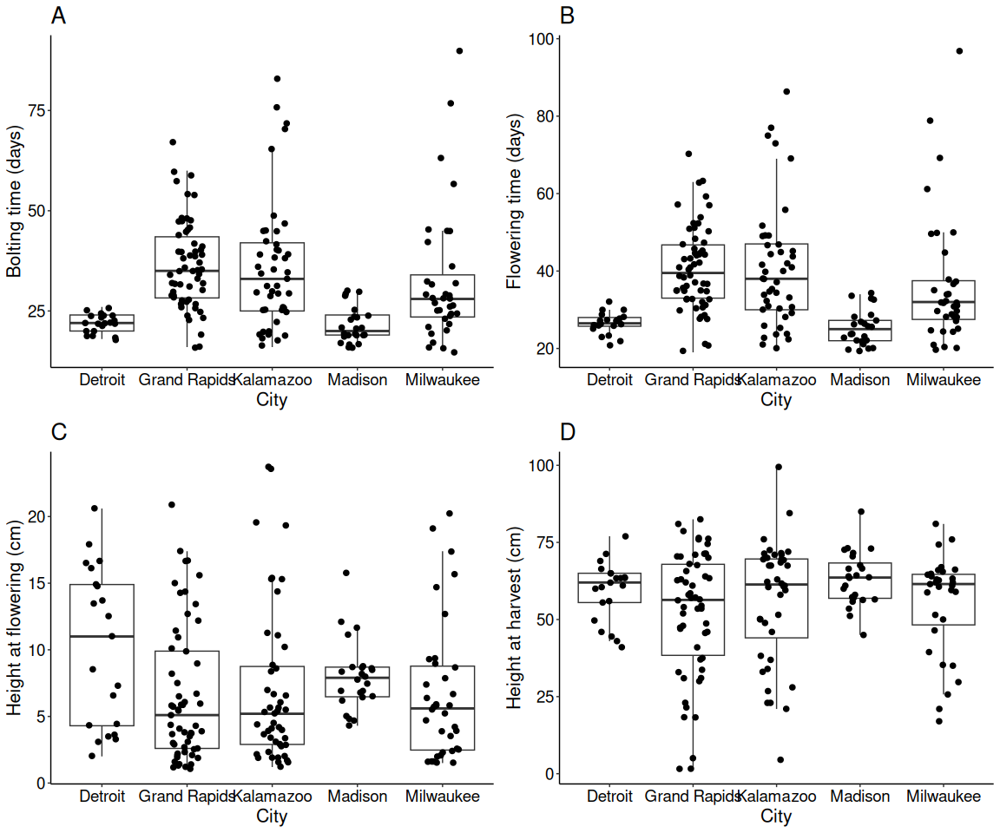
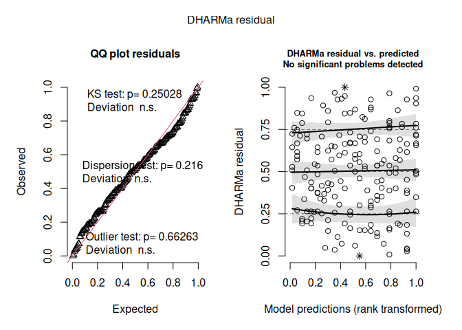
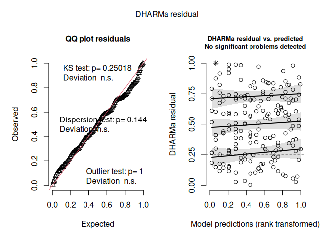
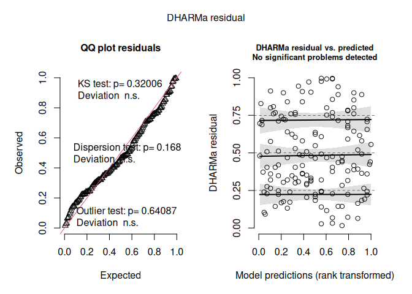
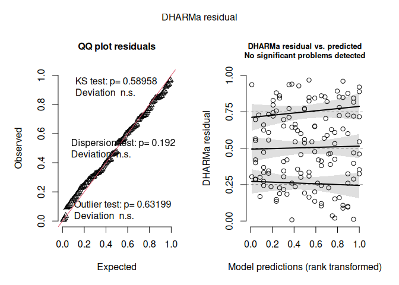
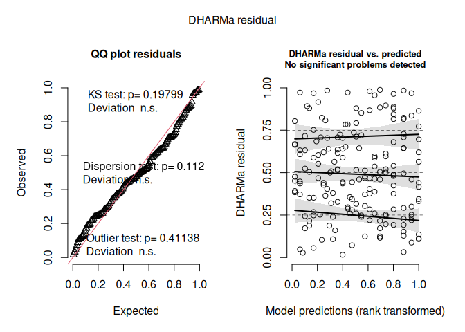
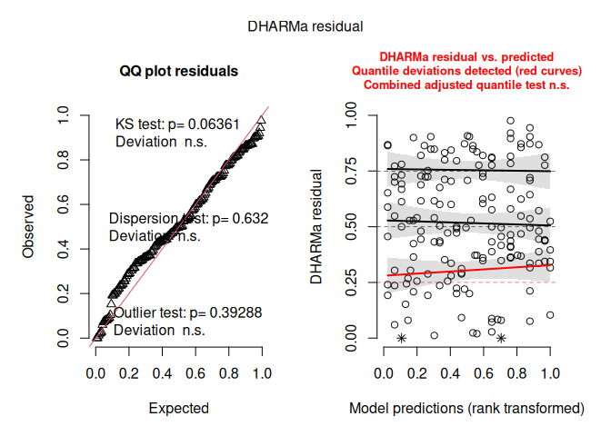
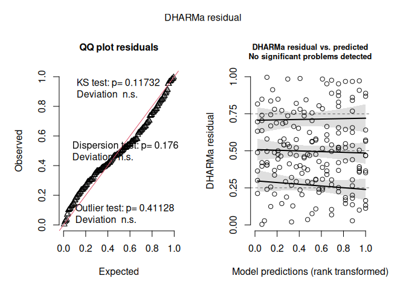
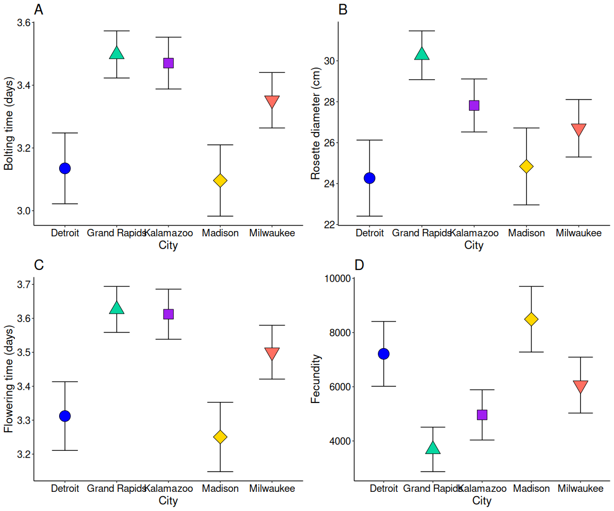

## 1. Load Packages


``` r
library(dplyr)
library(ggplot2)
library(car)
library(glmmTMB)
library(DHARMa)
library(emmeans)
library(gridExtra)
```

## 2. Data Preparation and Outlier Removal

Load the raw first-harvest dataset, compute composite phenotypes (`Fecundity` and `BushyScore`), subset to Midwest growth chamber (`GC`) individuals, and remove univariate outliers (> 3 SD from each city's mean).


``` r
Harv1Individuals <- read.csv("../data/1stHarvRformatedSeeds_Nov27.csv")
Harv1Individuals$City <- as.factor(Harv1Individuals$City)

# Calculate Fecundity and Bushiness Score
Harv1Individuals <- Harv1Individuals %>%
  mutate(
    Fecundity = (Seed_count / 5) * N_Fruits,
    across(c(HavHeight_Scaled, Rosbranches_Scaled, Caulibranches_Scaled), ~ as.vector(scale(.))),
    BushyScore = (Rosbranches_Scaled - Caulibranches_Scaled - HavHeight_Scaled) / 2
  )

write.csv(Harv1Individuals, "../data/FinalDataAll_Nov27.csv", row.names = FALSE)

# Subset to Midwest growth chamber individuals
Harv1GCMidWestInd <- Harv1Individuals %>%
  filter(GrowingConditions == "GC", City != "New York") %>%
  droplevels()

# Measured traits to screen for within-city univariate outliers (> 3 SD)
measured_traits <- c(
  "Rosette_D", "Height_Flower", "Height_Harvest", "N_Fruits",
  "Rosette_branches", "Cauline_branches", "DaysFridgetoGerm",
  "DaysPlantToBolt", "DaysBoltToFlower", "Seed_count", "Fecundity", "BushyScore"
)

remove_outliers_3sd <- function(x) {
  x <- as.numeric(x)
  z <- abs(x - mean(x, na.rm = TRUE)) / sd(x, na.rm = TRUE)
  ifelse(!is.na(z) & z > 3.0, NA_real_, x)
}

Harv1GCMidWestInd <- Harv1GCMidWestInd %>%
  group_by(City) %>%
  mutate(across(all_of(measured_traits), remove_outliers_3sd)) %>%
  ungroup() %>%
  mutate(
    # Derived phenotypes and transformations
    FlowerTime = DaysPlantToBolt + DaysBoltToFlower,
    TlogFH     = log(Height_Flower),
    HHreversed = max(Height_Harvest, na.rm = TRUE) + 1 - Height_Harvest,
    Tsqrt_HH   = sqrt(HHreversed),
    Tlog_FT    = log(FlowerTime),
    # Factor conversions
     across(c(City, Genotype, GrowingConditions, ParentGrowingConditions,
             ParentBlock, City_L, Population, Individual, F2_Rep), as.factor)
  )
```

## 3. Homogeneity of Variance (Levene's Tests) & Boxplots (Figure 2)

Test for differences in phenotypic variance across cities and parent growing conditions using Levene's test, followed by Benjamini-Hochberg FDR correction.


``` r
levene_traits <- c(
  "DaysPlantToBolt", "Rosette_D", "FlowerTime", "Tlog_FT",
  "TlogFH", "Tsqrt_HH", "BushyScore", "Fecundity"
)

levene_city_p <- sapply(levene_traits, function(tr) {
  leveneTest(reformulate("City", response = tr), data = Harv1GCMidWestInd)$`Pr(>F)`[1]
})

levene_pgc_p <- sapply(levene_traits, function(tr) {
  leveneTest(reformulate("ParentGrowingConditions", response = tr), data = Harv1GCMidWestInd)$`Pr(>F)`[1]
})

levene_results <- data.frame(
  Trait        = levene_traits,
  City_P       = levene_city_p,
  City_P_BH    = p.adjust(levene_city_p, method = "BH"),
  PGC_P        = levene_pgc_p,
  PGC_P_BH     = p.adjust(levene_pgc_p, method = "BH"),
  row.names    = NULL
)
print(levene_results)
```

```
##             Trait       City_P   City_P_BH        PGC_P     PGC_P_BH
## 1 DaysPlantToBolt 0.0001386247 0.000677484 2.190933e-05 0.0001752746
## 2       Rosette_D 0.4270130792 0.427013079 5.170083e-01 0.6893443939
## 3      FlowerTime 0.0001985917 0.000677484 6.538508e-05 0.0002615403
## 4         Tlog_FT 0.0002540565 0.000677484 6.465359e-03 0.0172409561
## 5          TlogFH 0.0006083683 0.001216737 7.407400e-01 0.8465599749
## 6        Tsqrt_HH 0.0041460161 0.006633626 4.344497e-02 0.0868899359
## 7      BushyScore 0.1908730762 0.218140659 4.810380e-01 0.6893443939
## 8       Fecundity 0.1347175325 0.179623377 8.676542e-01 0.8676541525
```

Generate Figure 2 boxplots illustrating raw variance across cities:


``` r
plot_variance_boxplot <- function(data, y_var, y_label, plot_title) {
  ggplot(data, aes(x = City, y = .data[[y_var]])) +
    geom_boxplot(outlier.shape = NA) +
    geom_jitter(width = 0.2, size = 2) +
    theme(
      panel.background = element_rect(fill = "white", colour = "white", linewidth = 0.5),
      panel.grid.major = element_blank(),
      panel.grid.minor = element_blank(),
      legend.position  = "none",
      axis.line        = element_line(linewidth = 0.5, colour = "black"),
      axis.text        = element_text(colour = "black", size = 14),
      axis.title       = element_text(size = 16),
      plot.title       = element_text(size = 20)
    ) +
    labs(x = "City", y = y_label, title = plot_title)
}

box_bolting   <- plot_variance_boxplot(Harv1GCMidWestInd, "DaysPlantToBolt", "Bolting time (days)", "A")
box_flowering <- plot_variance_boxplot(Harv1GCMidWestInd, "FlowerTime", "Flowering time (days)", "B")
box_fh        <- plot_variance_boxplot(Harv1GCMidWestInd, "Height_Flower", "Height at flowering (cm)", "C")
box_hh        <- plot_variance_boxplot(Harv1GCMidWestInd, "Height_Harvest", "Height at harvest (cm)", "D")

combined_Boxplots <- grid.arrange(
  box_bolting, box_flowering, box_fh, box_hh,
  ncol = 2, padding = unit(1, "cm")
)
```

<!-- -->

``` r
ggsave("Fig2_combined_Boxplots_Varience_600dpi_Oct25.tiff", combined_Boxplots, width = 20, height = 16, dpi = 600)
```

## 4. Generalized Linear Mixed Models (`glmmTMB`)

Fit full models (`ParentGrowingConditions + City + F2_Rep + (1 | Genotype)`) and reduced null models without `City` (`ParentGrowingConditions + F2_Rep + (1 | Genotype)`) using `glmmTMB`, compare via likelihood ratio tests (`anova`), and inspect `DHARMa` simulated residuals.


``` r
fit_city_glmm <- function(response, data, family = gaussian(), dispformula = ~ 1, reml = FALSE) {
  full_formula <- as.formula(paste(response, "~ ParentGrowingConditions + City + F2_Rep + (1 | Genotype)"))
  null_formula <- as.formula(paste(response, "~ ParentGrowingConditions + F2_Rep + (1 | Genotype)"))

  mod_city <- glmmTMB(full_formula, dispformula = dispformula, family = family, data = data, REML = reml)
  mod_null <- glmmTMB(null_formula, dispformula = dispformula, family = family, data = data, REML = reml)

  list(
    city_model = mod_city,
    null_model = mod_null,
    lrt        = anova(mod_null, mod_city)
  )
}
```

### 4.1 Rosette Diameter, Flowering Height, Bushiness Score, and Fecundity (Gaussian Models)


``` r
# Rosette Diameter
res_Rosette_D <- fit_city_glmm("Rosette_D", Harv1GCMidWestInd, family = gaussian())
summary(res_Rosette_D$city_model)
```

```
##  Family: gaussian  ( identity )
## Formula:          
## Rosette_D ~ ParentGrowingConditions + City + F2_Rep + (1 | Genotype)
## Data: data
## 
##       AIC       BIC    logLik -2*log(L)  df.resid 
##    1054.3    1089.7    -516.1    1032.3       175 
## 
## Random effects:
## 
## Conditional model:
##  Groups   Name        Variance Std.Dev.
##  Genotype (Intercept) 19.390   4.403   
##  Residual              7.178   2.679   
## Number of obs: 186, groups:  Genotype, 63
## 
## Dispersion estimate for gaussian family (sigma^2): 7.18 
## 
## Conditional model:
##                           Estimate Std. Error z value Pr(>|z|)    
## (Intercept)                24.8549     2.5572   9.720  < 2e-16 ***
## ParentGrowingConditionsGC   0.5029     2.1057   0.239  0.81125    
## ParentGrowingConditionsGH  -0.3850     2.2190  -0.174  0.86225    
## CityGrand Rapids            6.0061     2.1876   2.745  0.00604 ** 
## CityKalamazoo               3.5518     2.1863   1.625  0.10425    
## CityMadison                 0.5721     2.4377   0.235  0.81446    
## CityMilwaukee               2.4370     2.3130   1.054  0.29205    
## F2_Rep2                    -1.4630     0.4820  -3.035  0.00240 ** 
## F2_Rep3                    -0.4209     0.4825  -0.872  0.38308    
## ---
## Signif. codes:  0 '***' 0.001 '**' 0.01 '*' 0.05 '.' 0.1 ' ' 1
```

``` r
res_Rosette_D$lrt
```

```
## Data: data
## Models:
## mod_null: Rosette_D ~ ParentGrowingConditions + F2_Rep + (1 | Genotype), zi=~0, disp=~1
## mod_city: Rosette_D ~ ParentGrowingConditions + City + F2_Rep + (1 | Genotype), zi=~0, disp=~1
##          Df    AIC    BIC  logLik deviance  Chisq Chi Df Pr(>Chisq)  
## mod_null  7 1056.4 1079.0 -521.21   1042.4                           
## mod_city 11 1054.3 1089.8 -516.13   1032.3 10.156      4    0.03788 *
## ---
## Signif. codes:  0 '***' 0.001 '**' 0.01 '*' 0.05 '.' 0.1 ' ' 1
```

``` r
simulateResiduals(res_Rosette_D$city_model, plot = TRUE)
```

<!-- -->

```
## Object of Class DHARMa with simulated residuals based on 250 simulations with refit = FALSE . See ?DHARMa::simulateResiduals for help. 
##  
## Scaled residual values: 0.264 0.724 0.22 0.696 0.528 0.192 0.72 0.644 0.208 0.508 0.404 0.844 0.204 0.508 0.788 0.628 0.548 0.4 0.692 0.448 ...
```

``` r
# Flowering Height (log-transformed, city dispersion)
res_TlogFH <- fit_city_glmm("TlogFH", Harv1GCMidWestInd, family = gaussian(), dispformula = ~ City)
summary(res_TlogFH$city_model)
```

```
##  Family: gaussian  ( identity )
## Formula:          
## TlogFH ~ ParentGrowingConditions + City + F2_Rep + (1 | Genotype)
## Dispersion:              ~City
## Data: data
## 
##       AIC       BIC    logLik -2*log(L)  df.resid 
##     319.2     367.5    -144.6     289.2       170 
## 
## Random effects:
## 
## Conditional model:
##  Groups   Name        Variance Std.Dev.
##  Genotype (Intercept) 0.2702   0.5198  
##  Residual                 NA       NA  
## Number of obs: 185, groups:  Genotype, 63
## 
## Conditional model:
##                           Estimate Std. Error z value Pr(>|z|)    
## (Intercept)                2.22103    0.30790   7.214 5.45e-13 ***
## ParentGrowingConditionsGC -0.73782    0.26083  -2.829  0.00467 ** 
## ParentGrowingConditionsGH -0.06147    0.27339  -0.225  0.82210    
## CityGrand Rapids          -0.14455    0.26327  -0.549  0.58296    
## CityKalamazoo             -0.20163    0.26078  -0.773  0.43942    
## CityMadison               -0.08165    0.28220  -0.289  0.77234    
## CityMilwaukee             -0.20371    0.27734  -0.735  0.46263    
## F2_Rep2                    0.03071    0.06234   0.493  0.62231    
## F2_Rep3                    0.09055    0.06311   1.435  0.15130    
## ---
## Signif. codes:  0 '***' 0.001 '**' 0.01 '*' 0.05 '.' 0.1 ' ' 1
## 
## Dispersion model:
##                  Estimate Std. Error z value Pr(>|z|)    
## (Intercept)       -1.2332     0.1975  -6.244 4.28e-10 ***
## CityGrand Rapids   0.5102     0.2261   2.256   0.0241 *  
## CityKalamazoo      0.3767     0.2336   1.612   0.1069    
## CityMadison       -0.3989     0.2663  -1.498   0.1341    
## CityMilwaukee      0.4060     0.2473   1.642   0.1007    
## ---
## Signif. codes:  0 '***' 0.001 '**' 0.01 '*' 0.05 '.' 0.1 ' ' 1
```

``` r
res_TlogFH$lrt
```

```
## Data: data
## Models:
## mod_null: TlogFH ~ ParentGrowingConditions + F2_Rep + (1 | Genotype), zi=~0, disp=~City
## mod_city: TlogFH ~ ParentGrowingConditions + City + F2_Rep + (1 | Genotype), zi=~0, disp=~City
##          Df    AIC    BIC  logLik deviance  Chisq Chi Df Pr(>Chisq)
## mod_null 11 311.98 347.41 -144.99   289.99                         
## mod_city 15 319.23 367.53 -144.61   289.23 0.7596      4     0.9438
```

``` r
simulateResiduals(res_TlogFH$city_model, plot = TRUE)
```

<!-- -->

```
## Object of Class DHARMa with simulated residuals based on 250 simulations with refit = FALSE . See ?DHARMa::simulateResiduals for help. 
##  
## Scaled residual values: 0.344 0.608 0.208 0.824 0.28 0.54 0.58 0.376 0.744 0.536 0.704 0.484 0.676 0.028 0.884 0.548 0.588 0.644 0.84 0.632 ...
```

``` r
# Bushiness Score
res_BushyScore <- fit_city_glmm("BushyScore", Harv1GCMidWestInd, family = gaussian())
summary(res_BushyScore$city_model)
```

```
##  Family: gaussian  ( identity )
## Formula:          
## BushyScore ~ ParentGrowingConditions + City + F2_Rep + (1 | Genotype)
## Data: data
## 
##       AIC       BIC    logLik -2*log(L)  df.resid 
##     406.9     440.5    -192.4     384.9       146 
## 
## Random effects:
## 
## Conditional model:
##  Groups   Name        Variance Std.Dev.
##  Genotype (Intercept) 0.3795   0.6161  
##  Residual             0.4354   0.6598  
## Number of obs: 157, groups:  Genotype, 59
## 
## Dispersion estimate for gaussian family (sigma^2): 0.435 
## 
## Conditional model:
##                           Estimate Std. Error z value Pr(>|z|)  
## (Intercept)               -0.68031    0.40380  -1.685    0.092 .
## ParentGrowingConditionsGC  0.54400    0.33201   1.639    0.101  
## ParentGrowingConditionsGH  0.17036    0.34821   0.489    0.625  
## CityGrand Rapids          -0.30303    0.34506  -0.878    0.380  
## CityKalamazoo             -0.28964    0.34580  -0.838    0.402  
## CityMadison               -0.05885    0.37841  -0.156    0.876  
## CityMilwaukee             -0.09250    0.37076  -0.250    0.803  
## F2_Rep2                    0.07791    0.13098   0.595    0.552  
## F2_Rep3                   -0.04291    0.13171  -0.326    0.745  
## ---
## Signif. codes:  0 '***' 0.001 '**' 0.01 '*' 0.05 '.' 0.1 ' ' 1
```

``` r
res_BushyScore$lrt
```

```
## Data: data
## Models:
## mod_null: BushyScore ~ ParentGrowingConditions + F2_Rep + (1 | Genotype), zi=~0, disp=~1
## mod_city: BushyScore ~ ParentGrowingConditions + City + F2_Rep + (1 | Genotype), zi=~0, disp=~1
##          Df    AIC   BIC  logLik deviance  Chisq Chi Df Pr(>Chisq)
## mod_null  7 400.30 421.7 -193.15   386.30                         
## mod_city 11 406.88 440.5 -192.44   384.88 1.4237      4     0.8401
```

``` r
simulateResiduals(res_BushyScore$city_model, plot = TRUE)
```

<!-- -->

```
## Object of Class DHARMa with simulated residuals based on 250 simulations with refit = FALSE . See ?DHARMa::simulateResiduals for help. 
##  
## Scaled residual values: 0.904 0.888 0.296 0.32 0.436 0.508 0.332 0.716 0.288 0.48 0.144 0.352 0.312 0.94 0.204 0.404 0.304 0.228 0.176 0.276 ...
```

``` r
# Fecundity
res_Fecundity <- fit_city_glmm("Fecundity", Harv1GCMidWestInd, family = gaussian())
summary(res_Fecundity$city_model)
```

```
##  Family: gaussian  ( identity )
## Formula:          
## Fecundity ~ ParentGrowingConditions + City + F2_Rep + (1 | Genotype)
## Data: data
## 
##       AIC       BIC    logLik -2*log(L)  df.resid 
##    2580.8    2612.9   -1279.4    2558.8       125 
## 
## Random effects:
## 
## Conditional model:
##  Groups   Name        Variance Std.Dev.
##  Genotype (Intercept) 7267036  2696    
##  Residual             4653092  2157    
## Number of obs: 136, groups:  Genotype, 55
## 
## Dispersion estimate for gaussian family (sigma^2): 4.65e+06 
## 
## Conditional model:
##                           Estimate Std. Error z value Pr(>|z|)    
## (Intercept)                 6602.2     1687.0   3.914  9.1e-05 ***
## ParentGrowingConditionsGC    394.8     1429.0   0.276   0.7824    
## ParentGrowingConditionsGH   2157.2     1482.1   1.456   0.1455    
## CityGrand Rapids           -3523.8     1432.6  -2.460   0.0139 *  
## CityKalamazoo              -2251.4     1438.6  -1.565   0.1176    
## CityMadison                 1277.8     1557.7   0.820   0.4120    
## CityMilwaukee              -1152.5     1581.1  -0.729   0.4661    
## F2_Rep2                     -159.9      477.5  -0.335   0.7377    
## F2_Rep3                     -559.0      459.4  -1.217   0.2237    
## ---
## Signif. codes:  0 '***' 0.001 '**' 0.01 '*' 0.05 '.' 0.1 ' ' 1
```

``` r
res_Fecundity$lrt
```

```
## Data: data
## Models:
## mod_null: Fecundity ~ ParentGrowingConditions + F2_Rep + (1 | Genotype), zi=~0, disp=~1
## mod_city: Fecundity ~ ParentGrowingConditions + City + F2_Rep + (1 | Genotype), zi=~0, disp=~1
##          Df    AIC    BIC  logLik deviance  Chisq Chi Df Pr(>Chisq)  
## mod_null  7 2585.4 2605.8 -1285.7   2571.4                           
## mod_city 11 2580.8 2612.9 -1279.4   2558.8 12.534      4    0.01379 *
## ---
## Signif. codes:  0 '***' 0.001 '**' 0.01 '*' 0.05 '.' 0.1 ' ' 1
```

``` r
simulateResiduals(res_Fecundity$city_model, plot = TRUE)
```

<!-- -->

```
## Object of Class DHARMa with simulated residuals based on 250 simulations with refit = FALSE . See ?DHARMa::simulateResiduals for help. 
##  
## Scaled residual values: 0.848 0.16 0.424 0.632 0.852 0.152 0.96 0.02 0.088 0.78 0.608 0.108 0.724 0.532 0.008 0.936 0.844 0.644 0.228 0.94 ...
```

### 4.2 Bolting Time, Height at Harvest, and Flowering Time (Gamma Models with Dispersion)


``` r
gamma_disp <- ~ City + ParentGrowingConditions

# Bolting Time
res_Bolt <- fit_city_glmm("DaysPlantToBolt", Harv1GCMidWestInd, family = Gamma(link = "log"), dispformula = gamma_disp)
summary(res_Bolt$city_model)
```

```
##  Family: Gamma  ( log )
## Formula:          
## DaysPlantToBolt ~ ParentGrowingConditions + City + F2_Rep + (1 |      Genotype)
## Dispersion:                       ~City + ParentGrowingConditions
## Data: data
## 
##       AIC       BIC    logLik -2*log(L)  df.resid 
##    1205.5    1260.0    -585.8    1171.5       165 
## 
## Random effects:
## 
## Conditional model:
##  Groups   Name        Variance Std.Dev.
##  Genotype (Intercept) 0.07769  0.2787  
## Number of obs: 182, groups:  Genotype, 62
## 
## Conditional model:
##                            Estimate Std. Error z value Pr(>|z|)    
## (Intercept)                3.034794   0.155265  19.546  < 2e-16 ***
## ParentGrowingConditionsGC  0.231145   0.130370   1.773  0.07623 .  
## ParentGrowingConditionsGH  0.004935   0.135699   0.036  0.97099    
## CityGrand Rapids           0.363242   0.134506   2.701  0.00692 ** 
## CityKalamazoo              0.335630   0.134576   2.494  0.01263 *  
## CityMadison               -0.038689   0.147264  -0.263  0.79277    
## CityMilwaukee              0.217272   0.142486   1.525  0.12729    
## F2_Rep2                    0.006856   0.018336   0.374  0.70845    
## F2_Rep3                    0.057367   0.018563   3.090  0.00200 ** 
## ---
## Signif. codes:  0 '***' 0.001 '**' 0.01 '*' 0.05 '.' 0.1 ' ' 1
## 
## Dispersion model:
##                           Estimate Std. Error z value Pr(>|z|)    
## (Intercept)                 5.2466     0.4987  10.520   <2e-16 ***
## CityGrand Rapids           -0.9251     0.5184  -1.784   0.0743 .  
## CityKalamazoo              -0.7457     0.5222  -1.428   0.1533    
## CityMadison                 0.6815     0.5722   1.191   0.2337    
## CityMilwaukee              -0.8538     0.5253  -1.626   0.1040    
## ParentGrowingConditionsGC  -1.2568     0.4987  -2.520   0.0117 *  
## ParentGrowingConditionsGH   0.1014     0.4932   0.206   0.8371    
## ---
## Signif. codes:  0 '***' 0.001 '**' 0.01 '*' 0.05 '.' 0.1 ' ' 1
```

``` r
res_Bolt$lrt
```

```
## Data: data
## Models:
## mod_null: DaysPlantToBolt ~ ParentGrowingConditions + F2_Rep + (1 | Genotype), zi=~0, disp=~City + ParentGrowingConditions
## mod_city: DaysPlantToBolt ~ ParentGrowingConditions + City + F2_Rep + (1 | , zi=~0, disp=~City + ParentGrowingConditions
## mod_city:     Genotype), zi=~0, disp=~City + ParentGrowingConditions
##          Df    AIC  BIC  logLik deviance  Chisq Chi Df Pr(>Chisq)  
## mod_null 13 1210.3 1252 -592.17   1184.3                           
## mod_city 17 1205.5 1260 -585.76   1171.5 12.815      4    0.01221 *
## ---
## Signif. codes:  0 '***' 0.001 '**' 0.01 '*' 0.05 '.' 0.1 ' ' 1
```

``` r
simulateResiduals(res_Bolt$city_model, plot = TRUE)
```

<!-- -->

```
## Object of Class DHARMa with simulated residuals based on 250 simulations with refit = FALSE . See ?DHARMa::simulateResiduals for help. 
##  
## Scaled residual values: 0.244 0.216 0.916 0.524 0.504 0.468 0.172 0.88 0.716 0.188 0.604 0.632 0.352 0.552 0.972 0.072 0.24 0.296 0.444 0.852 ...
```

``` r
# Height at Harvest (square-root reversed)
res_HH <- fit_city_glmm("Tsqrt_HH", Harv1GCMidWestInd, family = Gamma(link = "log"), dispformula = gamma_disp)
summary(res_HH$city_model)
```

```
##  Family: Gamma  ( log )
## Formula:          
## Tsqrt_HH ~ ParentGrowingConditions + City + F2_Rep + (1 | Genotype)
## Dispersion:                ~City + ParentGrowingConditions
## Data: data
## 
##       AIC       BIC    logLik -2*log(L)  df.resid 
##     504.7     558.0    -235.3     470.7       153 
## 
## Random effects:
## 
## Conditional model:
##  Groups   Name        Variance Std.Dev.
##  Genotype (Intercept) 0.01856  0.1362  
## Number of obs: 170, groups:  Genotype, 60
## 
## Conditional model:
##                             Estimate Std. Error z value Pr(>|z|)    
## (Intercept)                1.8275251  0.0791733  23.083   <2e-16 ***
## ParentGrowingConditionsGC  0.0895542  0.0706038   1.268    0.205    
## ParentGrowingConditionsGH  0.0150664  0.0707694   0.213    0.831    
## CityGrand Rapids           0.0044468  0.0685903   0.065    0.948    
## CityKalamazoo              0.0008622  0.0715522   0.012    0.990    
## CityMadison               -0.0430283  0.0757095  -0.568    0.570    
## CityMilwaukee              0.0315414  0.0720734   0.438    0.662    
## F2_Rep2                   -0.0110003  0.0134814  -0.816    0.415    
## F2_Rep3                    0.0067092  0.0137748   0.487    0.626    
## ---
## Signif. codes:  0 '***' 0.001 '**' 0.01 '*' 0.05 '.' 0.1 ' ' 1
## 
## Dispersion model:
##                           Estimate Std. Error z value Pr(>|z|)    
## (Intercept)                 5.9174     0.5817  10.172  < 2e-16 ***
## CityGrand Rapids           -1.3690     0.5092  -2.688  0.00718 ** 
## CityKalamazoo              -2.4741     0.5338  -4.635 3.57e-06 ***
## CityMadison                -2.2724     0.5239  -4.338 1.44e-05 ***
## CityMilwaukee              -1.0072     0.5213  -1.932  0.05333 .  
## ParentGrowingConditionsGC  -1.1074     0.4682  -2.365  0.01801 *  
## ParentGrowingConditionsGH   1.2017     0.5005   2.401  0.01634 *  
## ---
## Signif. codes:  0 '***' 0.001 '**' 0.01 '*' 0.05 '.' 0.1 ' ' 1
```

``` r
res_HH$lrt
```

```
## Data: data
## Models:
## mod_null: Tsqrt_HH ~ ParentGrowingConditions + F2_Rep + (1 | Genotype), zi=~0, disp=~City + ParentGrowingConditions
## mod_city: Tsqrt_HH ~ ParentGrowingConditions + City + F2_Rep + (1 | Genotype), zi=~0, disp=~City + ParentGrowingConditions
##          Df    AIC    BIC  logLik deviance  Chisq Chi Df Pr(>Chisq)
## mod_null 13 497.62 538.39 -235.81   471.62                         
## mod_city 17 504.66 557.97 -235.33   470.66 0.9603      4     0.9158
```

``` r
simulateResiduals(res_HH$city_model, plot = TRUE)
```

<!-- -->

```
## Object of Class DHARMa with simulated residuals based on 250 simulations with refit = FALSE . See ?DHARMa::simulateResiduals for help. 
##  
## Scaled residual values: 0.848 0.424 0.336 0.54 0.364 0.6 0.432 0.208 0.844 0.012 0.9 0.704 0.616 0.528 0.28 0.352 0.724 0.288 0.712 0.192 ...
```

``` r
# Flowering Time
res_FlowerTime <- fit_city_glmm("FlowerTime", Harv1GCMidWestInd, family = Gamma(link = "log"), dispformula = gamma_disp)
summary(res_FlowerTime$city_model)
```

```
##  Family: Gamma  ( log )
## Formula:          
## FlowerTime ~ ParentGrowingConditions + City + F2_Rep + (1 | Genotype)
## Dispersion:                  ~City + ParentGrowingConditions
## Data: data
## 
##       AIC       BIC    logLik -2*log(L)  df.resid 
##    1203.4    1257.8    -584.7    1169.4       164 
## 
## Random effects:
## 
## Conditional model:
##  Groups   Name        Variance Std.Dev.
##  Genotype (Intercept) 0.06279  0.2506  
## Number of obs: 181, groups:  Genotype, 62
## 
## Conditional model:
##                           Estimate Std. Error z value Pr(>|z|)    
## (Intercept)                3.21782    0.13938  23.086  < 2e-16 ***
## ParentGrowingConditionsGC  0.18902    0.11727   1.612 0.106999    
## ParentGrowingConditionsGH  0.01630    0.12195   0.134 0.893681    
## CityGrand Rapids           0.31434    0.12073   2.604 0.009223 ** 
## CityKalamazoo              0.30013    0.12047   2.491 0.012726 *  
## CityMadison               -0.06155    0.13221  -0.466 0.641527    
## CityMilwaukee              0.18818    0.12768   1.474 0.140518    
## F2_Rep2                    0.02386    0.01556   1.534 0.125006    
## F2_Rep3                    0.05370    0.01562   3.438 0.000586 ***
## ---
## Signif. codes:  0 '***' 0.001 '**' 0.01 '*' 0.05 '.' 0.1 ' ' 1
## 
## Dispersion model:
##                           Estimate Std. Error z value Pr(>|z|)    
## (Intercept)                 5.5432     0.4764  11.636   <2e-16 ***
## CityGrand Rapids           -1.1667     0.5135  -2.272   0.0231 *  
## CityKalamazoo              -0.7008     0.5329  -1.315   0.1885    
## CityMadison                 0.3784     0.5783   0.654   0.5128    
## CityMilwaukee              -0.9377     0.5365  -1.748   0.0805 .  
## ParentGrowingConditionsGC  -1.2030     0.5085  -2.366   0.0180 *  
## ParentGrowingConditionsGH   0.3285     0.5078   0.647   0.5176    
## ---
## Signif. codes:  0 '***' 0.001 '**' 0.01 '*' 0.05 '.' 0.1 ' ' 1
```

``` r
res_FlowerTime$lrt
```

```
## Data: data
## Models:
## mod_null: FlowerTime ~ ParentGrowingConditions + F2_Rep + (1 | Genotype), zi=~0, disp=~City + ParentGrowingConditions
## mod_city: FlowerTime ~ ParentGrowingConditions + City + F2_Rep + (1 | Genotype), zi=~0, disp=~City + ParentGrowingConditions
##          Df    AIC    BIC logLik deviance Chisq Chi Df Pr(>Chisq)   
## mod_null 13 1208.8 1250.4 -591.4   1182.8                           
## mod_city 17 1203.4 1257.8 -584.7   1169.4  13.4      4   0.009479 **
## ---
## Signif. codes:  0 '***' 0.001 '**' 0.01 '*' 0.05 '.' 0.1 ' ' 1
```

``` r
simulateResiduals(res_FlowerTime$city_model, plot = TRUE)
```

<!-- -->

```
## Object of Class DHARMa with simulated residuals based on 250 simulations with refit = FALSE . See ?DHARMa::simulateResiduals for help. 
##  
## Scaled residual values: 0.124 0.488 0.848 0.668 0.368 0.5 0.256 0.78 0.836 0.208 0.476 0.744 0.336 0.444 0.988 0.036 0.24 0.4 0.292 0.804 ...
```

## 5. Least-Squares Means (EMMs) Plots (Figure 3)

Compute marginal means by `City` using `emmeans` and plot Figure 3 panels for Bolting Time, Rosette Diameter, Flowering Time, and Fecundity.


``` r
city_labels <- c("Detroit", "Grand Rapids", "Kalamazoo", "Madison", "Milwaukee")
city_fills  <- c("blue", "#06d6a0", "purple", "gold", "#ff6f61")
city_shapes <- c(21, 24, 22, 23, 25)

plot_lsmeans <- function(model, y_label, plot_title) {
  emm_df <- as.data.frame(emmeans(model, ~ City))

  ggplot(emm_df, aes(x = City, y = emmean)) +
    geom_errorbar(aes(ymin = emmean - SE, ymax = emmean + SE, color = City), width = 0.5, linewidth = 0.5) +
    geom_point(aes(shape = City, colour = City, fill = City), size = 7) +
    scale_colour_manual(values = rep("black", 5), labels = city_labels) +
    scale_fill_manual(values = city_fills, labels = city_labels) +
    scale_shape_manual(values = city_shapes, labels = city_labels) +
    theme(
      panel.background = element_rect(fill = "white", colour = "white", linewidth = 0.5),
      panel.grid.major = element_blank(),
      panel.grid.minor = element_blank(),
      legend.position  = "none",
      axis.line        = element_line(linewidth = 0.5, colour = "black"),
      axis.text        = element_text(colour = "black", size = 14),
      axis.title       = element_text(size = 16),
      plot.title       = element_text(size = 20)
    ) +
    labs(x = "City", y = y_label, title = plot_title)
}

DaysPlantToBolt_plot <- plot_lsmeans(res_Bolt$city_model, "Bolting time (days)", "A")
Rosette_plot         <- plot_lsmeans(res_Rosette_D$city_model, "Rosette diameter (cm)", "B")
Flowering_plot       <- plot_lsmeans(res_FlowerTime$city_model, "Flowering time (days)", "C")
Fecundity_plot       <- plot_lsmeans(res_Fecundity$city_model, "Fecundity", "D")

combined_LSPLOTS <- grid.arrange(
  DaysPlantToBolt_plot, Rosette_plot, Flowering_plot, Fecundity_plot,
  ncol = 2, padding = unit(1, "cm")
)
```

<!-- -->

``` r
ggsave("combined_LSPLOTS_600.tiff", combined_LSPLOTS, width = 20, height = 16, dpi = 600)
```

## 6. Multiple Testing (FDR) Corrections

Apply Benjamini-Hochberg FDR adjustments across model comparison p-values.


``` r
P_Table1 <- c(0.0113, 0.0242, 0.0096, 0.5376, 0.4884, 0.3802, 0.0121)
fdr_P_Table1 <- p.adjust(P_Table1, method = "BH")
print(fdr_P_Table1)
```

```
## [1] 0.02823333 0.04235000 0.02823333 0.53760000 0.53760000 0.53228000 0.02823333
```

``` r
P_Table2 <- c(0.012, 0.038, 0.009, 0.944, 0.916, 0.822, 0.014)
fdr_P_Table2 <- p.adjust(P_Table2, method = "BH")
print(fdr_P_Table2)
```

```
## [1] 0.03266667 0.06650000 0.03266667 0.94400000 0.94400000 0.94400000 0.03266667
```

``` r
GxE_P_Calculated <- c(0.8390, 0.6393, 0.6536, 0.8911, 0.4718, 0.7394, 0.0931)
fdr_P_GxE <- p.adjust(GxE_P_Calculated, method = "BH")
print(fdr_P_GxE)
```

```
## [1] 0.8911 0.8911 0.8911 0.8911 0.8911 0.8911 0.6517
```

``` r
GxE_P_Model <- c(0.582, 0.281, 0.298, 0.689, 0.570, 0.410, 0.003)
fdr_P_GxE_Model <- p.adjust(GxE_P_Model, method = "BH")
print(fdr_P_GxE_Model)
```

```
## [1] 0.679 0.679 0.679 0.689 0.679 0.679 0.021
```
